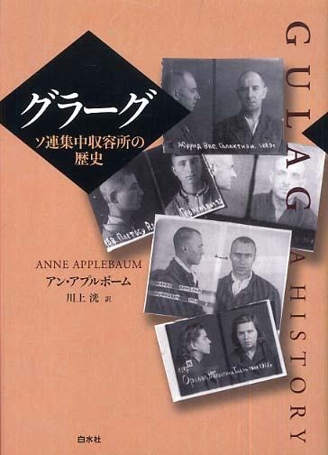
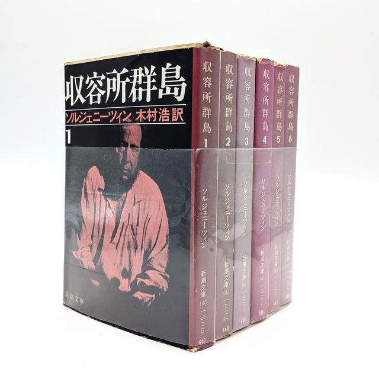
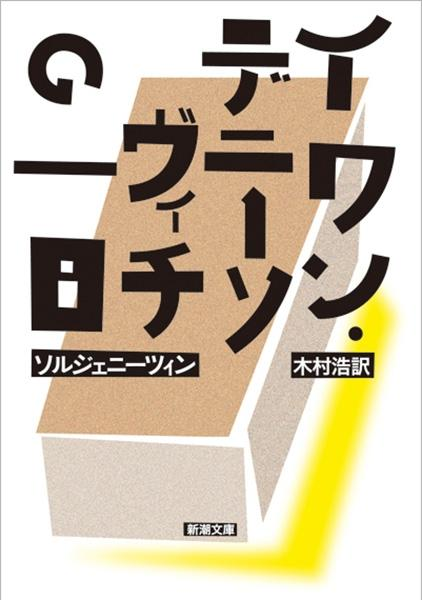
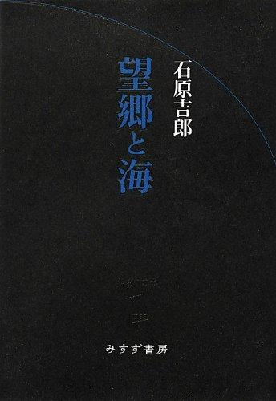
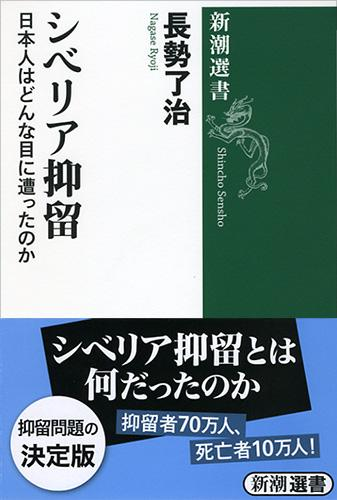

# 旧ソ連の「ラーゲリ」と「グラーグ」は何が違うのか――強制収容所の歴史と人間の極限状態を描いた名著8冊

現在、ロシア当局によって北海道新聞ユジノサハリンスク支局の今井裕紀記者が拘束されている。いち早い解放を望むばかりだ。一方で、ロシアの収容所、拘置所がどのようなものなのかが、改めて気になった。日本人にとって、シベリア抑留で多くの人命を失った歴史もある。ここで、旧ソ連、ロシアのそういった場所がどのようなものかがわかる書籍にどのようなものがあるのかを数冊、紹介したい。

旧ソ連の強制収容所を語る際、「ラーゲリ」と「グラーグ」という二つの言葉が登場する。似た意味で使われることも多いが、厳密には異なる。「ラーゲリ」（лагерь）はロシア語で「キャンプ」「収容所」を意味する一般名詞で、強制労働収容所だけでなく、捕虜収容所なども指す。日本では第二次世界大戦後、旧日本軍の将兵らがシベリアに抑留された歴史と結びつき、広く知られるようになった。

一方、「グラーグ」（ГУЛАГ）は、ソ連の「収容所総管理局」を意味するロシア語の略称である。政治犯や一般刑事犯らを収容する強制労働収容所を管理した行政組織を指し、現在では、その管轄下にあった強制収容所制度全体を意味する言葉としても使われる。

つまり、**ラーゲリは収容所そのものを指す言葉であり、グラーグは収容所を管理する組織、さらにはその制度を指す言葉**なのである。

また、日本人捕虜らを収容した施設は、主としてグラーグとは別系統の捕虜・抑留者管理機関の管轄下にあった。この区別は、ソ連の収容所制度を理解するうえで重要だ。

ラーゲリの歴史は、日本人のシベリア抑留よりもはるかに古い。ロシア革命後のソ連では、政治犯や「反革命分子」とされた人々を収容する施設が設けられ、とりわけスターリン時代には巨大な強制労働収容所制度へと発展した。そこに収容されたのは、反体制活動家だけではなかった。共産党幹部、知識人、農民、軍人、そして政治とはほとんど無縁の一般市民までが、国家の政策によって自由を奪われた。

こうした収容所制度は、どのように生まれ、なぜ巨大化したのか。また、極限状態に置かれた人間は、何を考え、どのように生き延びたのだろうか。

## ソ連の収容所制度を知るための基本文献

最初に挙げたいのが、アメリカの歴史家・ジャーナリスト、アン・アプルボームの**『グラーグ――ソ連集中収容所の歴史』**（白水社、2006年）である。

アプルボームは、ソ連崩壊後に公開された公文書や元収容者の証言などを幅広く用い、収容所制度の成立から拡大、そして衰退までを体系的に描いた。

注目すべきは、収容所を単なる政治的弾圧の手段としてだけではなく、ソ連経済を支える強制労働の供給源として分析している点だ。北極圏やシベリアの鉱山開発、森林伐採、鉄道・運河建設などに大量の囚人が投入された。ソ連の工業化と強制収容所制度が密接な関係にあったことを理解できる。同書は2004年にピュリツァー賞を受賞した。ラーゲリを歴史的に研究する際の出発点となる一冊だ。

もう一つの重要な著作が、アレクサンドル・ソルジェニーツィンの『収容所群島』（新潮社）である。

自身も収容所に送られたソルジェニーツィンは、多数の元囚人の証言を集め、逮捕、尋問、移送、労働、抵抗といった一連の過程を膨大な記録としてまとめ上げた。1973年に国外で刊行されたこの作品は、ソ連の政治体制に対する巨大な告発となった。ただし、厳密な歴史研究書というよりも、個人の経験と証言を組み合わせた文学的記録として読むべきだろう。

## 収容所の内部では何が起きていたのか

ラーゲリの日常を知るうえで最も読みやすい作品が、ソルジェニーツィンの『イワン・デニーソヴィチの一日』（新潮文庫）だ。

主人公は、収容所で暮らす一人の平凡な囚人である。小説は、彼が朝起きてから夜眠るまでの、わずか一日を描いている。十分な食事も暖房もない生活の中で、囚人たちはわずかなパンを確保するために知恵を絞り、厳しい労働に耐える。看守や仲間との関係にも、収容所独特の秩序が存在する。1962年、スターリン批判が進むフルシチョフ時代のソ連で発表されたこの作品は、収容所の実態を一般読者に伝える画期的な文学作品となった。

ソルジェニーツィンには、個人的な思い出がある。1992年だったか、来日した際の講演会に行ったことがある。訳者の木村浩先生も一緒に登壇されたものだった。当時はソ連が崩壊した直後で、ソルジェニーツィンはソ連を強く非難したが、木村先生も完全同調した内容の話をされて、やや鼻白んだ記憶がある。それ以上に、当時の通訳が米原万里さんだった。終わった後に、ご一緒した恩師と会った。「もう、観客の方たちはロシア語がわかっている人ばかりで、とても緊張したわ」とおっしゃっていた。このときから、米原さんのファンになった。

一方、さらに過酷な収容所生活を描いたのが、ヴァルラーム・シャラーモフの『極北 コルィマ物語』（朝日新聞社）である。

舞台は、ソ連極東のコルィマ地方。金鉱などが存在するこの地域には、多数の囚人が送り込まれた。シャラーモフ自身も長年にわたり収容所生活を経験した。彼が描くのは、飢餓や寒さ、暴力によって人間の精神が破壊されていく世界だ。

ソルジェニーツィンの作品には極限状態でも人間の尊厳を守ろうとする姿が見られるが、シャラーモフは、収容所が人間性そのものを奪う場所であったことを冷徹に表現している。

女性の視点から描いた重要な証言としては、エヴゲーニヤ・ギンズブルグの『明るい夜暗い昼』（集英社文庫など）がある。ギンズブルグは1937年、スターリンによる大粛清の中で逮捕された。自身が共産主義を信奉していたにもかかわらず、国家から敵とみなされ、長期の拘禁と収容所生活を強いられた。

なぜソ連は、革命や体制を支持していた人々まで弾圧したのか。同書はその問題を考えるうえでも重要な証言となっている。

## 日本人のシベリア抑留をどう位置づけるか

日本人のラーゲリ体験を知るためには、石原吉郎の『望郷と海』（ちくま学芸文庫）をすすめたい。

詩人として知られる石原は、戦後、約8年間にわたりシベリアに抑留された。その体験をもとに、極限状態における人間の心理、自由と尊厳、他者との関係などについて深く考察している。

同書が優れているのは、抑留生活の悲惨さを描くだけでなく、人間が自由を奪われたとき、何を支えに生きていくのかという普遍的な問題を問いかけている点にある。

歴史研究としては、長勢了治の『シベリア抑留全史』（原書房、2013年）が重要だ。日本人が抑留された背景から、各地の収容所の実態、帰還問題までを幅広く取り上げている。

さらに長勢は2025年、『シベリア抑留の全収容所を解き明かす』（原書房）を刊行した。個々の収容所の位置や実態を具体的に調べるための専門書である。

## ラーゲリの歴史が現代に問いかけるもの

ソ連の強制収容所について学ぶことは、過去の独裁国家の犯罪を振り返るだけではない。国家が国民を政治的に分類し、裁判や適正な手続きを軽視して自由を奪い、労働力として利用する。そうした制度が、いかにして巨大な官僚機構の一部となっていったのかを考えることでもある。

その意味で、アプルボームの『グラーグ』とソルジェニーツィンの『収容所群島』は、制度の全体像を理解するための重要な二冊といえる。

そして、収容所内部の人間の姿をより深く知りたければ、シャラーモフの『極北 コルィマ物語』や石原吉郎の『望郷と海』を読み合わせるとよいだろう。巨大な国家制度の歴史と、そこに閉じ込められた一人ひとりの人間の記憶。その両方を知ることで、ラーゲリという存在の本当の意味が見えてくるのではないだろうか。
