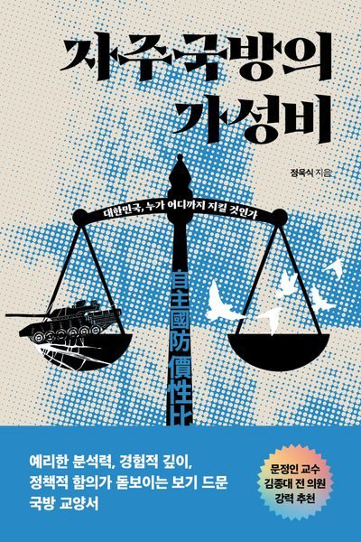

# トランプ大統領からのお墨付きを得た韓国の原子力潜水艦建造、はたして現実的か

**韓国の原子力潜水艦導入について、韓国で出版された鄭旭湜（チョン・ウクシク）『自主国防のコストパフォーマンス』（자주국바의 가성비、한겨레출판、2026年、未邦訳）から、原子力潜水艦（原潜／K原潜）に関して記述されている主要な内容を抽出・整理します。**

### 1. 歴代韓国政権における「韓国型原子力潜水艦（K原潜）」計画の経緯
* **盧武鉉（ノ・ムヒョン）政権**：2003年6月に海軍から報告された原潜建造計画を承認し、「362事業」という暗号名で秘密裏に推進しました。しかし、2004年に国際原子力機関（IAEA）が過去の韓国のウラン濃縮・プルトニウム抽出実験を問題視し、国連安保理へ回付される懸念が生じたため中断に追い込まれました。
* **文在寅（ムン・ジェイン）政権**：2017年の大統領選討論会で必要性に言及し、2020年には金鉉宗（キム・ヒョンジョン）国家安保室第2次長が核燃料エンジン搭載潜水艦の導入に言及、「国防中期計画」にも反映を試みましたが、米国の反対により反対・挫折しました。
* **李在明（イ・ジェミョン）政権**：2025年10月末の韓米首脳会談で燃料供給を打診し、同年11月14日に公開された韓米「共同説明資料」において「米国は韓国が原潜を建造することを承認し、燃料調達案を含め協力する」旨が盛り込まれ、再び表面化しました。

### 2. K原潜計画が抱える5つの構造的・政策的難関
著者（チョン・ウクシク氏）は、K原潜計画が単なる国内技術の問題を超えて以下の重大なハードルを抱えていると分析しています。

* **国際不拡散体制と協定の壁**：NPT（核不拡散条約）加盟の非核保有国が外部から核燃料の供給を受けて自前で原潜を建造・運用するモデルは国際的な前例がありません。既存の「韓米原子力協定」は民間利用に限られるため、別途「韓米軍事用核燃料供給協定（仮称）」の締結（約2〜3年）と米国議会（NDAA等）の承認が必要であり、米国の政治情勢に大きく左右されます。
* **「封印型モジュール」要求と技術・費用リスク**：韓国は「自国開発の小型原子炉＋米国産核燃料」の組み合わせを望んでいますが、米国が核燃料の統制権を100%保持するためにAUKUS（オーストラリア向け）同様「核燃料一体型の封印モジュール」の購入を求めてくる可能性があり、その場合自国開発構想が崩壊します。また、米海軍は高濃縮ウラン（HEU、90%級）を使用しており、軍事用低濃縮ウラン（LEU、20%未満）の生産・認証ラインを持たないため、 dedicated施設構築費などの不確定な請求書が韓国側に転嫁されるリスクがあります。
* **IAEA査察および理事会承認の難航**：IAEAには軍事用核物質を監視・査察する既存メカニズムがないため個別交渉が不可欠であり、35カ国で構成されるIAEA理事会（3分の2の賛成等）で中国やロシアが「特恵的な悪しき前例」として激しく牽制・反対することが予測されます。
* **米国の対中牽制への組み込み（戦略的従属性）**：米国（太平洋司令部・米海軍）は韓国への原潜導入支援を対中牽制（台湾海峡や第1列島線防衛等）の一環と捉えています。米国の要求に応じれば対中関係が決定的に悪化し、拒否すれば原潜計画自体が阻まれるという「従属のジレンマ」が発生します。
* **天文学的な予算と「コストパフォーマンス」の低さ**：建造費だけで数十兆ウォン・10年以上の歳月を要する上、2025年11月の共同声明で示されたように大規模な対米投資や軍事装備購入（計5,580億ドル規模）といった過剰な代価を支払わされています。

### 3. 著者の結論と現実的代替案（ディーゼル潜水艦の活用）
* 莫大な費用と多重の不確実性を伴うK原潜よりも、すでに技術的成熟度が高く水中隠密性に優れた**ディーゼル推進潜水艦（3,600トン級大型化、AIP・リチウムイオン電池搭載、SLBM搭載型等）**の拡充を選択する方が、短期間かつ圧倒的に低予算で実効的な反撃（第2撃）能力を確保できる「最高のコストパフォーマンス」を持つ現実的選択であると結論づけています。

### 4. 北朝鮮（朝鮮）の原子力潜水艦開発動向
* 北朝鮮も2021年の第8回党大会で原子力潜水艦および長距離SLBMの開発目標を提示しましたが、原潜の建造・運用には「技術的・産業的障壁が極めて高く」、現在も完成段階には至っていないと分析されています。

### 5. その他の関連記述
* 進歩派（革新）政治家（ユン・グォンヨン等）による「自主国防のために原子力潜水艦を導入すべき」という主張に対し、著者はそれが安保のジレンマを深め失敗を繰り返す「二重思考」であると批判しています。
* 米国の拡大抑止（核の傘）をアピールする戦略資産の派遣として、米軍の原子力潜水艦が韓国に時折展開されている点が言及されています。

**既存のディーゼル潜水艦の場合、「反撃能力（第2撃能力）」の具体的運用構想と戦略的意義について整理します。**

### 1. 「反撃能力（第2撃能力）」の概念と核心目的
* **概念の定義**：本書における反撃能力とは、先制打撃（キルチェーン）能力ではなく、**「相手から攻撃を受けた際に、生存している戦力で確実に報復・大量膺懲を加える能力」**を意味します。
* **抑止のメカニズム**：相手に「先制攻撃を行っても、事後的に耐えがたい壊滅的被害を受ける」と正しく認識させることで、武力攻撃そのものを断念させます（「恐怖の均衡」）。
* **「戦争防止」という交差点**：韓国が自ら先に戦争を起こす意思がないことを前提としつつ、相手の攻撃を抑止することに特化することで、「力による平和（自主国防）」と「関係による平和（平和共存）」の共通目標である**「戦争防止」**を果たします。

### 2. なぜ原子力潜水艦（原潜）ではなく「ディーゼル潜水艦」なのか
* **技術的成熟度と圧倒的コスパ**：韓国はすでに3,600トン級への大型化、AIP（空気不要推進）やリチウムイオン電池による長時間の水中潜航能力、そしてSLBM（潜水艦発射弾道ミサイル）運用能力を備えており、極めて高い技術的成熟度に達しています。
* **K原潜の難関の回避**：天文学的な予算（数十兆ウォン）と10年以上の歳月、さらにNPT/IAEAの査察、米国の軍事用核燃料供給協定や米議会承認といった多重の難関を抱える原潜計画に対し、既存のディーゼル潜水艦の改修・拡充は**短期間かつ圧倒的に低い予算で構築できる「最高のコストパフォーマンス」**を備えています。
* **高い隠密性と生存性**：地上基地や航空戦力と異なり、水中に潜伏する潜水艦は相手の先制攻撃を生き延びる確率が極めて高いため、「第2撃（報復）拠点」として最も優れています。

### 3. 「韓国型3軸体系」の再編構想
著者は、軍拡競争と「安保のジレンマ」を激化させている従来の「3軸体系」を次のように見直すことを提言しています。

* **先制打撃（Kill Chain）および「斬首作戦」の除外**：
  * 先制打撃は情報誤解による全面核戦争のリスクが高く、朝鮮（北朝鮮）の核武力法に明記された「指揮部攻撃時の自動即時核打撃（死んだ者の手）」を刺激して致命的な結果をもたらすため、除外すべきだとしています。
* **過剰なミサイル防衛（KAMD/MD）の抑制**：
  * ミサイル1発を迎撃するために数発の高額な迎撃ミサイルを要するMDへの過剰投資を抑え、生存性の高い潜水艦やミサイルによる「大量応懲報復（反撃能力）」に焦点を絞ることで、軍事費の無駄と安保のジレンマを最小化します。

