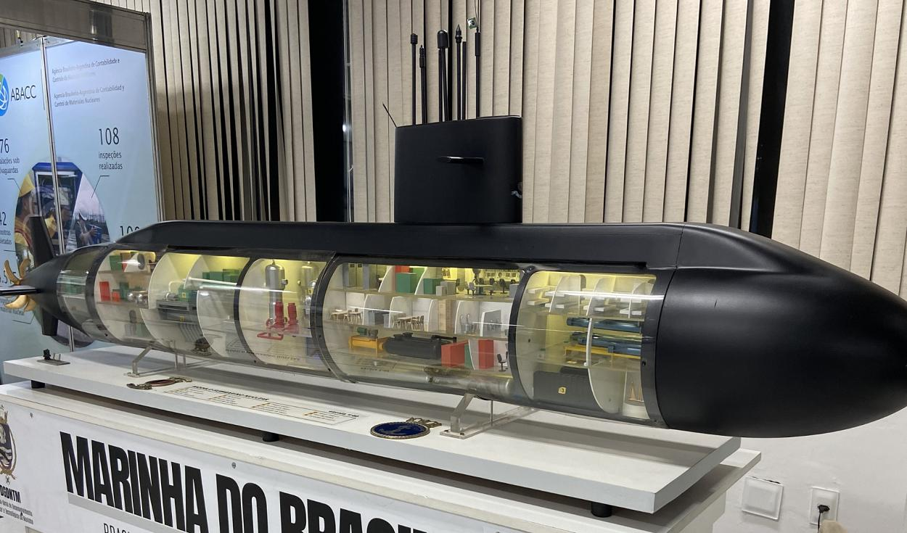

# 核兵器を持たない国が原潜を造る――ブラジルが突きつけるNPTの「例外」とIAEA査察の新たな課題

核兵器を保有しないブラジルが、原子力潜水艦の建造を進めている。原子炉も核燃料も国産化するという野心的な計画だ。だが、核兵器不拡散条約（NPT）は、核兵器を持たない国による軍事目的の原子力利用をどこまで認めているのか。潜水艦に搭載される核燃料を国際原子力機関（IAEA）が査察することは可能なのか。ブラジルは2026年3月、NPT再検討会議に向けた文書で独自の検証制度について説明した。半世紀に及ぶ原潜開発が、国際的な核不拡散体制に新たな課題を突きつけている。

## 南米初の原潜建造、完成目標は2038年

ブラジルの原子力潜水艦建造計画が、新たな段階を迎えている。

2026年9月、ブラジル国営企業NUCLEPは、同国初の原子力潜水艦「アルミランチ・アルヴァロ・アルベルト」（S50）の耐圧船殻を製造するための、試験用構造物を完成させた。

これは実際の潜水艦に組み込まれるものではない。船体に使う鋼材や溶接技術、製造設備、作業員の技能などが、厳格な建造基準を満たしているかどうかを確認するための構造物だ。

防衛専門メディア『Janes』によれば、潜水艦は現在も詳細設計の段階にあり、本格的な船体建造の開始日は確定していない。しかし、ブラジル海軍は2038年の就役を目指している。

ブラジルの原子力潜水艦計画は、1970年代の軍事政権時代にさかのぼる。

当時のブラジルは、核燃料製造や原子炉開発で外国への依存から脱却し、原子力技術の自主開発を目指していた。1979年には海軍が原子力技術開発に本格的に乗り出した。

計画が大きく前進したのは2008年である。ルラ大統領とフランスのサルコジ大統領が防衛協力を進めることで合意し、ブラジルはフランスの技術協力を受けながら、通常動力型潜水艦4隻と原子力潜水艦1隻を建造する計画を始めた。

ただし、フランスが協力するのは主として潜水艦の設計や船体建造などの分野である。原子炉と核燃料については、ブラジル自身が開発する。

ブラジルが原潜を必要とする背景には、広大な海洋権益がある。

2026年3月にブラジル政府が国連に提出した文書によると、同国が海洋資源に関する管轄権を有するとする海域は約570万平方キロメートルに及ぶ。ブラジルの石油生産の約85％、天然ガス生産の約75％がこの海域で行われ、対外貿易の約95％が海上輸送を経由する。

同国が「青いアマゾン」と呼ぶ南大西洋の海洋権益を守るうえで、長期間の潜航が可能な原子力潜水艦は重要な装備になると考えられている。

ところが、ここで一つの疑問が生じる。核兵器を持たないブラジルが、なぜ軍事目的の原子力潜水艦を建造できるのだろうか。

## NPTが認める「禁止されていない軍事活動」とは

ブラジルは1998年、核兵器不拡散条約（NPT）に加盟した。NPTは、アメリカ、ロシア、中国、イギリス、フランスの5カ国を条約上の核兵器国とし、それ以外の締約国には核兵器の製造や取得を禁止している。

しかし、NPTが禁止しているのは核兵器やその他の核爆発装置であり、原子力を軍艦の推進に利用すること自体ではない。

原子力潜水艦は、原子炉から得られる熱で推進力を生み出す。核兵器を搭載する必要はない。

実際、ブラジルが開発している潜水艦は、魚雷などの通常兵器を搭載する「原子力推進・通常兵器搭載型潜水艦」である。

ブラジル政府は、原潜の推進に使う原子力は核兵器の開発とは異なると説明し、NPT上の義務と矛盾しないと主張している。

その根拠となるのが、IAEAの包括的保障措置協定に設けられた「禁止されていない軍事活動」（non-proscribed military activity）に関する規定だ。

IAEAの包括的保障措置協定は、非核兵器国が核物質を核兵器に転用していないことを確認する仕組みである。

ところが、原子力潜水艦の推進用核燃料は、核兵器ではないものの、軍事用の装備に使用される。

このような特殊な用途を想定し、IAEAの保障措置協定には、一定の条件のもとで通常とは異なる手続きを認める仕組みがある。ブラジルが利用しようとしているのは、この規定である。

つまり、NPTに原子力潜水艦を自由に建造できるという明文の例外があるわけではない。核兵器以外の軍事用途に核物質を使用する際、通常の保障措置の適用方法を調整する制度が用意されているのである。

この違いは重要だ。ブラジルが原潜を建造すること自体はNPTに違反しない。しかし、その原子炉に使われる核燃料を、国際社会がどのように監視するのかという問題が残る。

## 原潜の核燃料はIAEA査察の対象外になるのか

通常、IAEAは非核兵器国の原子力施設を査察し、ウランやプルトニウムなどの核物質が核兵器に転用されていないかを確認する。

核物質の量や組成を調べ、施設の運転記録と照合するほか、必要に応じて封印や監視装置などを使用する。

しかし、核燃料が軍事用の潜水艦に搭載されると、通常の査察は難しくなる。

潜水艦の内部構造や原子炉の性能、燃料の仕様などには軍事機密が含まれる。しかも、潜水艦は長期間にわたって海中で活動する。IAEA査察官が随時立ち入り、核燃料の状態を確認できるわけではない。

そこで問題になるのが、通常の保障措置から外れる期間の核物質をどう扱うかという点だ。

IAEAの保障措置協定では、核物質が禁止されていない軍事活動に使用される場合、通常とは異なる手続きを適用することが想定されている。

ただし、核物質が核兵器の製造に転用されないことを確保する必要があり、査察義務そのものが無条件に消滅するわけではない。

ここに潜在的な危険がある。

例えば、ある非核兵器国が原子力潜水艦の建造を宣言し、核燃料を通常のIAEA査察から外したとする。その後、実際には潜水艦に使用せず、核兵器開発に転用した場合、検証制度が不十分なら発見が難しくなる可能性がある。

こうした制度上の問題は、核不拡散の専門家の間で「海軍原子力推進の抜け穴」として議論されてきた。

もちろん、ブラジルが核兵器開発を企図しているという意味ではない。重要なのは、将来ほかの国が同じ仕組みを利用した場合にも、核不拡散体制の信頼性を維持できる制度を構築することである。

## アルゼンチンも参加する特殊な査察体制

ブラジルの原潜計画には、ほかの国にはない特徴がある。

それは、IAEAだけでなく、隣国アルゼンチンも関わる核物質の相互監視体制が存在していることだ。

ブラジルとアルゼンチンは、かつて原子力開発を競い合っていた。しかし民主化後、両国は相互の核開発に対する不信感を取り除くため、核物質の共同管理に踏み出した。

1991年には「ブラジル・アルゼンチン核物質計量管理機関」（ABACC）を設立した。

この仕組みでは、両国の核施設を相互に査察する。さらにIAEAも検証に加わることで、二重の保障措置体制が成立している。

同年12月には、ブラジル、アルゼンチン、ABACC、IAEAの4者による保障措置協定が締結された。これが「四者協定」である。

重要なのは、この協定の第13条だ。

同条は、核物質を潜水艦や試作設備を含む原子力推進に使用する場合、特別な手続きを設けることを認めている。

ブラジルは、原潜開発を進めるために新たな例外規定を要求しているのではない。30年以上前に成立した四者協定の条項を実際に適用しようとしているのである。

2026年7月には、ブラジルの原子力安全当局が四者協定に関する技術会合の開催を発表した。IAEAとABACCは、2025年にブラジルの施設で実施した査察について、肯定的な結果を報告したという。

## 2026年3月、ブラジルが公表した新たな査察構想

そのブラジルが、2026年3月3日、国連に重要な文書を提出した。

NPT再検討会議に向けた作業文書「ブラジルの海軍原子力推進計画とNPT下の保障措置体制」である。

この文書によれば、ブラジルは2021年12月にIAEAに対して特別手続きに関する協議を始める意向を伝え、2022年5月には最初の具体案を提出した。

以来、ブラジル、IAEA、ABACCの3者は平均して年3回程度の協議を重ね、原子炉施設への技術的な訪問や情報交換を続けてきた。

2025年には、3者による技術作業部会が設置された。

この作業部会では、陸上に建設する試験用原子炉と、将来潜水艦に搭載する原子炉の核燃料について、どのような技術や機器を使って検証するかを議論している。

2026年3月の文書でブラジル政府は、核燃料に含まれる核物質を検証するための技術的構想について、共通認識に達したと説明した。

さらに、ABACCが原子力推進に使用する核物質の総量と組成を記録する役割を担うことも明らかにしている。

ブラジルは、使用済み核燃料を再処理する計画はなく、冷却プールで保管した後、長期的な乾式貯蔵施設に移し、通常の包括的保障措置に戻す方針だ。

ただし、2026年10月時点で、原潜用核燃料の特別手続きについて最終合意が成立したことを示す公表資料は確認できない。

2025年11月のIAEA理事会では、欧州連合（EU）が協議の進展を歓迎する一方、最終的な取り決めが完成した段階でIAEA理事会が適切な対応を取ることへの期待を示している。

## 追加議定書を締結していないブラジルの事情

さらに、ブラジルにはもう一つの特徴がある。

IAEAの「追加議定書」を締結していないことだ。追加議定書は、イラクや北朝鮮などの核開発問題を背景に、未申告の核物質や原子力活動を発見するためのIAEAの権限を強化する制度として整備された。従来の包括的保障措置協定に加え、原子力関連活動について幅広い情報提供を求め、必要に応じて施設への補完的アクセスを認める仕組みである。

ブラジル政府は、追加議定書への参加は各国の自主的な判断によるものであり、原子力潜水艦の建造を認められる法的な前提条件ではないという立場を取っている。また、IAEAとABACCによる二重の検証体制があるため、核物質の管理について高い透明性を確保していると説明する。

一方、EUは2025年11月のIAEA理事会で、包括的保障措置協定と追加議定書の普及を引き続き支持すると表明した。これは、ブラジルがNPTに違反しているという主張ではない。ただし、追加議定書を締結していない場合、IAEAが未申告の核活動について検証できる範囲には制約がある。原潜用核燃料という特殊な用途に、どこまで厳格な検証が必要なのか。ブラジルの計画は、この問題を改めて浮き彫りにしている。

## オーストラリアも原潜を導入、異なる核燃料の管理

この問題は、ブラジルだけのものではない。

アメリカ、イギリス、オーストラリアの安全保障協力枠組み「AUKUS」によって、オーストラリアも原子力潜水艦の導入を進めている。

同国も核兵器を持たないNPT加盟国であり、IAEAとの間で原潜用核燃料の保障措置について協議している。

ただし、ブラジルとオーストラリアでは技術的な事情が異なる。ブラジルは、低濃縮ウランを使う原子炉を独自に開発している。これに対して、オーストラリアが導入する原潜は、米英から提供される高濃縮ウランを用いた原子力推進装置を使用する予定だ。また、オーストラリアは追加議定書を締結しているが、ブラジルは締結していない。

2026年1月、アメリカのカーネギー国際平和財団は、両国の原潜計画に関する研究報告書を公表した。報告書は、原潜用核燃料の検証には技術的、制度的な難しさがあり、両国に同一の査察方法をそのまま適用することはできないと指摘している。今後、原子力潜水艦を保有する非核兵器国が増えれば、こうした個別の検証制度が国際的な核管理の先例となっていく可能性がある。

## 核不拡散体制の新たな試金石に

ブラジルの原子力潜水艦建造は、現時点でNPTに違反するものとは認められていない。しかし、NPTで禁止されていないことと、国際的な査察制度が十分に整備されていることは、同じではない。ブラジルは、核兵器を持たず、通常兵器を搭載する原子力潜水艦を建造する方針を掲げている。核燃料も自国で製造し、IAEAとABACCによる検証を受け入れようとしている。その意味では、核不拡散体制に協力しながら、独自の軍事用原子力技術を確立しようとする国家の新しい事例といえる。

一方、国際社会にとっては、別の問題が残る。将来、ほかの非核兵器国が原子力潜水艦の建造を理由に、核物質を通常の査察から外すよう求めた場合、どのような条件で認めるべきなのか。そして、軍事機密を守りながら、核兵器への転用が行われていないことを、どこまで確実に検証できるのか。

ブラジルが進めているのは、原子力潜水艦という新しい兵器の建造だけではない。核兵器を持たない国による原子力の軍事利用を、NPTとIAEAの枠組みの中でどのように管理するかという、国際的な制度づくりでもある。

原潜の就役目標は2038年。しかし、その原子炉に核燃料を装荷する前に、国際社会は重要な問いへの答えを出さなければならない。核兵器の拡散を防ぎながら、原子力潜水艦の保有を認めることは可能なのか。ブラジルとIAEAが進める協議は、今後の核不拡散体制のあり方を左右する試金石となりそうだ。

主な参考資料：ブラジル政府「NPT/CONF.2026/WP.13」（2026年3月3日）、EUのIAEA理事会声明（2025年11月19日）、カーネギー国際平和財団の研究報告書（2026年1月29日）、Janes（2026年9月）、ブラジル原子力安全当局（2026年7月）。