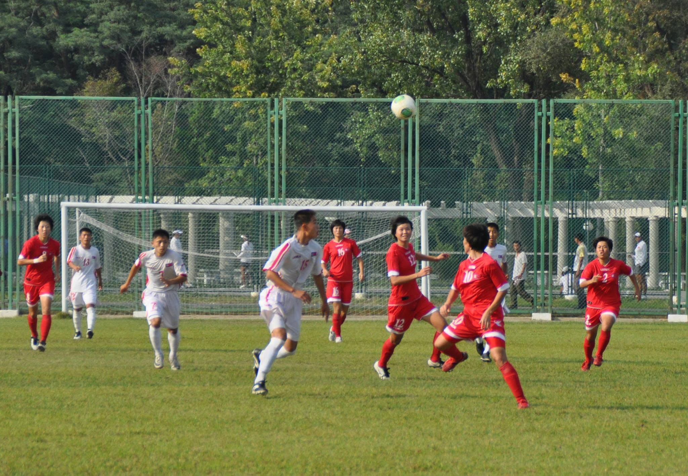

# 世界を席巻する北朝鮮女子サッカー　強さの秘密はどこにあるのか、ユース年代で圧倒的な存在感

**（平壌国際サッカー学校で男女選手が練習試合を行っている。2013年撮影）**

近年、女子サッカー界で最も安定した成功を収めている国の一つが北朝鮮である。とりわけU-17、U-20年代では世界的な強豪として君臨しており、その勢いは日本やスペイン、米国といった伝統的強国をしのぐほどだ。

2024年にはU-20女子ワールドカップとU-17女子ワールドカップの両方を制覇した。さらにアジア選手権にあたるAFC U-20女子アジアカップとAFC U-17女子アジアカップでも優勝し、主要ユース大会の“四冠”を達成した。FIFAは近年の北朝鮮を「女子ユースサッカー界を支配している存在」と評価している。

北朝鮮女子サッカーの強さは決して一過性のものではない。2006年のU-20女子ワールドカップ初優勝以来、20年近くにわたり世界トップクラスの地位を維持してきた。近年はむしろその優位性がさらに際立っている。

では、その強さはいったいどこから生まれているのだろうか。

## 国家主導の育成システム

専門家がまず指摘するのは、国家主導による一貫した育成体制である。

スポーツと政治を研究するエディンバラ大学のLee Jung-woo氏は、2013年に創設された平壌国際サッカー学校の存在を重要視している。同校は有望な選手を全国から集め、全寮制に近い形で体系的な指導を行う育成機関とされる。男子だけでなく女子選手の養成にも力を入れ、幼少期から継続的なトレーニングを施しているという。

欧州ではクラブアカデミーが担う役割を、北朝鮮では国家が一元的に管理している形だ。

この仕組みによって有望選手を早期に発掘できるだけでなく、選手たちは同じ年代の仲間と長期間プレーを続けることができる。そのためチーム戦術の共有や連携の熟成が進みやすい。

## 「同じ世代」が成長し続ける強み

FIFAも北朝鮮の成功について、「多くの選手が同じグループのまま年代別代表を上がっていくこと」が大きな要因だと分析している。

例えばU-17代表で世界一になった選手たちが、その後U-20代表へ昇格し、さらにA代表へと進む。その間も同じ仲間とプレーするため、連携は年々深まる。

欧州や日本ではクラブ間の移籍や競争によって代表メンバーが頻繁に入れ替わるが、北朝鮮では比較的固定された集団が長く戦う傾向がある。

その結果、初対面の選手同士が組むチームではなく、「何年も一緒にプレーしてきた集団」として大会に臨むことができるのである。

## 最大の武器はハイプレス

戦術面で最も特徴的なのは、前線から相手に圧力をかけるハイプレスだ。

北朝鮮の選手たちはボールを失うと即座に奪い返しに行く。フォワードが追い込み、ミッドフィルダーが連動してプレッシャーを掛け、最終ラインも高く保つ。

この積極的な守備によって相手のビルドアップを寸断し、自陣で落ち着いてパスを回す時間を与えない。

2024年のU-20女子ワールドカップでは、日本やオランダなど技術力の高いチームですら北朝鮮のプレッシングに苦しんだ。大会を通じて25得点を記録した攻撃力も、この守備から生まれるショートカウンターに支えられていた。

## ポゼッションより縦への速さ

近年の世界サッカーでは、スペインに代表されるポゼッション志向が主流となっている。

しかし北朝鮮は異なる。

ボール保持率そのものを追求するのではなく、「奪ったら最短距離でゴールを目指す」ことを重視する。相手からボールを奪った直後に前方へ展開し、数本のパスでフィニッシュに持ち込むケースが多い。

また、攻撃時には複数の選手が一気にゴール前へ雪崩れ込み、相手守備陣に数的不利を強いる。

日本のような細かなパス交換による崩しというよりも、運動量とスピードを生かしたダイレクトな攻撃が北朝鮮の持ち味と言える。

## フィジカルと組織力の融合

対戦国の指導者たちが共通して指摘するのは、その運動量とフィジカルの強さだ。

2026年の女子アジアカップを前に、日本代表監督のNils Nielsenは北朝鮮について「非常にフィジカルが強く、走り続けることができる」と評価した。

球際の競り合いを恐れず、試合終盤まで強度が落ちない。しかも単に体力があるだけではなく、組織的な守備原則が徹底されている。

各選手が自ら判断して自由に動くというより、チームとして統一された動きを共有しているため、守備の連動性が非常に高いのである。

## A代表への課題も

もっとも、ユース年代での成功がそのままA代表での支配につながっているわけではない。

世界トップレベルのA代表は、技術力、戦術の柔軟性、海外リーグでの経験など、より複合的な要素が求められる。北朝鮮は国内育成の完成度が高い反面、欧州リーグなどでの経験を積む機会は限られている。

それでも2023年アジア競技大会では準優勝を果たし、再びアジアの有力国として存在感を高めている。

## 「国家プロジェクト」が生んだ強豪

北朝鮮女子サッカーを一言で表現するなら、「国家主導の育成システムによって作り上げられた組織型チーム」である。

全国規模の選抜制度、平壌国際サッカー学校を中心とした育成機関、長期間維持される世代別チーム、そしてハイプレスと速攻を軸とする明確な戦術思想。これらが相互に結び付くことで、世界屈指の競争力を生み出している。

近年の国際大会で示された実績は偶然ではない。北朝鮮女子サッカーは今や、女子ユース年代における世界最高水準の育成モデルの一つとして注目されているのである。