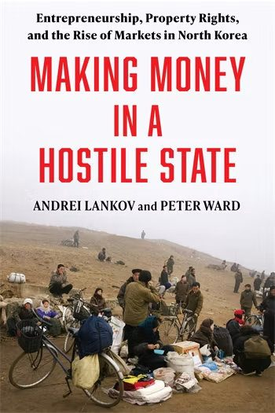

# Making Money in a Hostile State：Entrepreneurship, Property Rights, and the Rise of Markets in North Korea

この本は、北朝鮮の経済と政治体制を理解するうえで、非常に興味深い研究書です。

とくに注目したいのは、\*\*「私有財産も民間企業も原則として認めない北朝鮮で、なぜ市場経済が発展し、民間の起業家が活動できるようになったのか」\*\*という問題を、約40年間の歴史から解き明かそうとしている点です。

著者は、北朝鮮研究者として知られるアンドレイ・ランコフ（Andrei Lankov）教授と、政治経済研究者のピーター・ウォード（Peter Ward）氏です。

ただし、2026年11月3日現在、本書はまだ刊行前で、2027年2月2日の発売予定です。以下はコロンビア大学出版局が公表している紹介文に基づく概要と、そこから読み取れる研究上の意義を整理したものです。全文を読んだうえでの書評ではありません。

[出版社の公式紹介ページ](https://cup.columbia.edu/book/making-money-in-a-hostile-state/9780231567022/?utm_source=chatgpt.com)

## 1. 本書の中心的な問題意識

本書が描こうとしているのは、公式の社会主義経済と、実際に北朝鮮住民が営んでいる経済活動との大きな乖離です。

北朝鮮では、制度上は国家が生産手段を所有し、経済活動を計画・管理することになっています。

しかし、現実には市場が住民生活の隅々まで浸透しています。農産物の生産・販売から漁業、家庭内の製造業、流通、畜産に至るまで、個人の利益を目的とする経済活動が広がっています。

ランコフ氏とウォード氏は、こうした市場を単なる違法な闇取引とは捉えていません。

国家の公的な制度、地方当局の対応、個人の経済活動が複雑に絡み合い、北朝鮮独自の市場秩序を形成してきた過程を明らかにしようとしています。

## 2. 4つの産業分野を詳しく分析

出版社の紹介によれば、本書は特に4つの経済分野を取り上げています。

| 分野      | 主な研究対象                   |
| ------- | ------------------------ |
| 農業      | 国家・協同農場の制度と、農民による市場向け生産  |
| 漁業      | 漁獲・販売活動と国家機関の関係          |
| 家内生産・流通 | 個人や家庭による商品製造、商品流通、市場での販売 |
| 畜産      | 家畜の飼育や販売を通じた民間の経済活動      |

重要なのは、小規模な個人の商売だけでなく、国家機関の内部に組み込まれた比較的大規模な事業活動も研究対象としていることです。

ここから、北朝鮮経済の市場化が、単に住民による国家への抵抗によって起きたのではなく、国家機関自身の経済活動とも結びついていることが浮かび上がります。

## 3. 私有財産が認められないのに、なぜ企業経営が成立するのか

副題にある「Property Rights（財産権）」は、本書の重要なキーワードです。

一般的に企業活動には、資産を所有する権利、利益を受け取る権利、財産を他人に譲渡する権利などが必要です。

ところが北朝鮮では、こうした権利が十分に法的保障を受けていません。

それにもかかわらず、商売が続き、資金が蓄積され、事業が拡大するのはなぜでしょうか。

本書の紹介内容からは、次のような問題が重要になると考えられます。

- 国家機関の名義を利用した民間事業は、どのように運営されるのか。
- 地方の党・行政幹部と民間の商人は、どのような利害関係を築いているのか。
- 法的に不安定な財産や投資を、事業者はどのように守っているのか。
- 中央政府が民間経済を規制しても、市場活動が存続するのはなぜか。

これらは、出版社が列挙した個別の結論ではなく、本書の研究テーマから導かれる問いです。

とりわけ注目されるのが、北朝鮮のいわゆる「トンジュ（돈주、銭主）」との関係でしょう。

トンジュは、市場化の過程で資金を蓄積し、国家機関などと関係を築きながら事業を営む資金提供者・実業家を指します。

本書がその具体的な仕組みをどこまで解明しているのかは、刊行後に確認したいところです。

## 4. 国家は市場を弾圧しているのか、それとも利用しているのか

この本のもう一つの焦点は、国家による市場統制の変化です。

出版社の説明によると、著者たちは過去40年間の市場形成を追跡するとともに、国家が経済活動に対する政治的支配を維持するために、その政策をどのように変化させてきたかを分析しています。

北朝鮮の市場化を考える場合、1990年代の深刻な経済危機は重要な転換点でした。国家配給制度が機能不全に陥ったことで、多くの住民が自力で食料や生活必需品を確保するようになったためです。

その後、国家は市場活動を一定程度容認する一方、必要に応じて規制を強化してきました。

ここで興味深いのは、国家と市場を単純な対立関係として理解できない点です。

市場が国家の経済統制を弱体化させる可能性がある一方、国家機関が市場から利益を得たり、住民の生活維持を市場に依存したりする側面もあります。

つまり、市場化が進めば必ず国家統制が弱まるとは限らないのです。むしろ、市場経済が体制の存続に役立っている可能性があります。

本書は、この逆説的な関係を検討する研究として読むことができるでしょう。

## 5. 研究方法にも注目する価値がある

出版社によれば、本書は次のような資料を使用しています。

- 著者らによる北朝鮮脱出住民への独自インタビュー
- 脱北者の回想録
- 北朝鮮の公式資料
- 外部に流出した北朝鮮内部文書

特に、脱北者証言と北朝鮮の内部資料を組み合わせている点が重要です。

北朝鮮経済の研究では、脱北者の証言に依存する場合、出身地域や脱北時期、経済的地位による偏りが生じやすいという問題があります。

他方、公式資料だけでは制度と現実の乖離を把握しにくいという限界があります。

本書が異なる資料をどのように照合し、検証しているかは、学術的な評価において重要なポイントになると思います。

## 6. 金正恩政権の経済政策を理解するうえでの意義

私が特に興味深いと思うのは、本書の問題意識が金正恩政権の経済政策を考えるうえで重要な視点を提供することです。

金正恩政権は、経済活動への国家の指導・統制を強調する一方、すでに市場に依存するようになった経済構造も抱えています。

このため、次のような問いが生じます。

第一に、国家の統制強化は、市場そのものの縮小を意味するのでしょうか。

市場をなくすのではなく、その運営主体や利益配分を国家がより強く管理する方向も考えられます。

第二に、民間資本は国家の統制にどこまで従属しているのでしょうか。

資金を提供する民間事業者が国家機関の名義や許可に依存していれば、経済的には成功していても政治的には脆弱な立場に置かれます。

第三に、北朝鮮の市場化は体制変革を促すのでしょうか。それとも体制を延命させるのでしょうか。

これは北朝鮮研究で長く議論されてきた問題です。本書の分析は、その議論に新しい実証的な材料を提供する可能性があります。

ただし、以上の3点は本書の記述として確認できた結論ではなく、刊行後に検討すべき論点として挙げています。

## 7. この本の研究上の位置づけ

ランコフ氏は、北朝鮮の政治体制と社会の変化を長年研究してきた学者です。ソウルの国民大学教授で、1984年には北朝鮮への留学経験もあります。

共著者のウォード氏は、北朝鮮の政治経済を研究する世宗研究所の研究者です。

本書は、この2人による政治体制研究と経済制度研究を結びつけた成果と位置づけられます。

私が注目しているのは、北朝鮮市場経済の研究が「市場がどれほど広がったか」という量的な問題から、「市場はどのような制度と政治的関係によって維持されているか」という構造的な問題に進んでいることです。

この視点は、北朝鮮を単なる失敗した計画経済として説明することの限界も浮き彫りにします。

## 取材・記事化の観点から

この本を記事にするなら、私は次のような切り口が有力だと思います。

「私有財産を認めない北朝鮮で、なぜ企業家が生まれるのか――市場経済が独裁体制を支える逆説」

特に、ランコフ氏に直接取材する機会があるなら、次の3点を尋ねてみたいところです。

1. 北朝鮮の民間事業者は、国家に財産を没収される危険とどのように折り合いをつけているのか。
2. 金正恩政権は市場経済を縮小しようとしているのか、それとも国家による管理の下に再編しようとしているのか。
3. 北朝鮮の市場化は、長期的には政治的な自由化につながるのか。それとも中国などとは異なる独自の権威主義的な市場経済が定着するのか。

本書は、核・ミサイルや対外政策からでは見えにくい、北朝鮮体制の内部構造を考えるための重要な研究になる可能性があります。

なお、現時点で確認できる出版社の公開情報だけでは、各章の詳しい議論や著者の最終的な結論までは断定できません。刊行後には、章ごとの議論を検証し、従来の北朝鮮市場化研究と比較する価値が十分にあると思います。

https://amzn.asia/d/08u6BMfZ