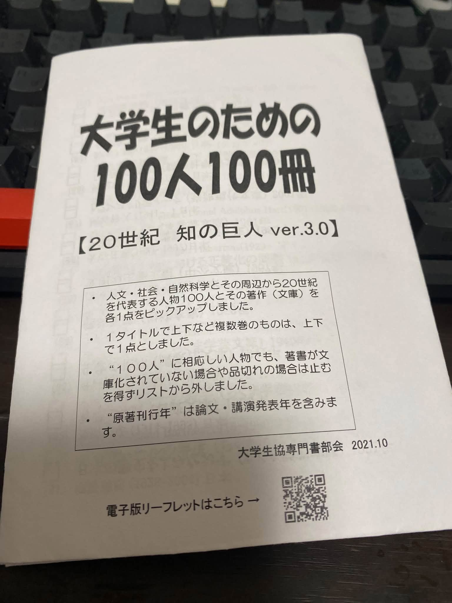

# 大学生のための「100人100冊」──20世紀の知を未来へ手渡すブックガイドの意義

大学生協が編んだ「大学生のための100人100冊 20世紀 知の巨人」は、単なる読書案内ではありません。20世紀という激動の時代を生き、世界と人間の在り方を根底から問い続けた知の巨人たちの思索を、21世紀を担う若者へ手渡すための知的装置です。本ガイドは、人文・社会・自然科学の広範な領域から100名の代表的著者を選び、その主要著作を文庫で読める形に整理しています。学生が自らの関心を広げ、深め、時代を批判的に読み解くための「知の地図」として極めて優れた構成になっています。

まず注目すべきは、選書の軸が「現代の古典」に置かれている点です。アインシュタイン『相対性理論』、ヴィトゲンシュタイン『論理哲学論考』、ケインズ『一般理論』、アレント『人間の条件』、フーコー『知の考古学』など、20世紀の知的地形を決定づけた著作が網羅されています。これらは専門分野を超えて、現代社会の根本問題を理解するための必読書です。たとえば、カーソン『沈黙の春』は環境問題の原点を示し、ダイアモンド『銃・病原菌・鉄』は文明の差異を生み出した構造的要因を明らかにします。こうした書物は、学生が世界を「自分の問題」として捉えるための視座を提供します。

また、本ガイドは哲学・社会思想の比重が高く、20世紀思想の多様性を体感できる構成になっています。サルトル『存在と無』、ハイデガー『存在と時間』、デリダ『声と現象』、ドゥルーズ＝ガタリ『アンチ・オイディプス』など、難解ながらも現代思想の源流を形成した著作が並びます。これらは学生にとって容易ではありませんが、若い時期に触れることで思考の柔軟性が培われ、世界の見え方が大きく変わります。大学生協があえて「難解な古典」を選んでいる点は、知的挑戦を促す姿勢として高く評価できます。

さらに、自然科学の名著が充実している点も特徴です。ゲーデル『不完全性定理』、シュレーディンガー『生命とは何か』、湯川秀樹『物理講義』、ウィーナー『サイバネティックス』など、科学史の転換点となった書物が揃っています。これらは科学を専門としない学生にとっても、科学的思考の本質を理解するための格好の教材です。特にシュレーディンガーの著作は、生命科学と物理学の境界を横断する知的興奮を与えてくれます。

社会科学の領域では、ヴェーバー『プロテスタンティズムの倫理と資本主義の精神』、丸山眞男『超国家主義の論理と心理』、ロールズ『公正としての正義再説』など、社会の構造と倫理を考えるための重要書が選ばれています。これらは現代の政治・社会問題を理解するための基礎となり、学生が公共性や正義について自らの言葉で語る力を育てます。

本ガイドの優れている点は、単なる名著の羅列ではなく、20世紀という時代そのものを「知の鏡」として提示しているところにあります。二度の世界大戦、冷戦、科学技術の飛躍、環境破壊、消費社会の到来──こうした歴史的経験の中で、知の巨人たちは自らの立脚点を揺るがすほどの思索を展開しました。その成果を体系的に読み解くことは、混迷を深める21世紀を生きる学生にとって不可欠です。

学生時代は、知的な「立ち止まり」が許される希少な時間です。本ガイドは、その立ち止まりを促し、思考の旅へと誘う羅針盤として機能します。100冊の中からどれを選ぶかは学生自身の自由ですが、どの一冊も世界の見え方を変える力を持っています。大学生協がこのような選書をまとめたことは、学びの場を支える組織としての責任と情熱の表れであり、学生にとって大きな財産となるはずです。